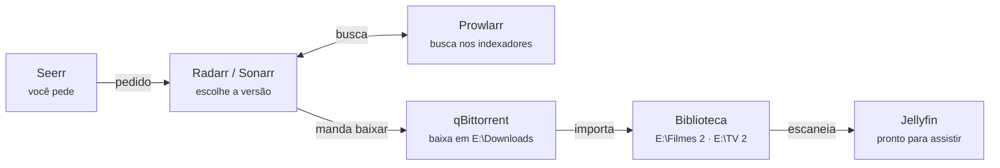

# Central de Mídia Jellyfin — Guia de uso

Stack Docker para assistir filmes, séries e TV ao vivo em casa, e para pedir títulos novos.

## Visão geral

No dia a dia você só usa dois endereços: o **Jellyfin** para assistir e o **Seerr** para pedir algo novo. O resto trabalha sozinho por trás. Todos rodam em Docker, a partir do `docker-compose.yml` desta pasta.

| Serviço | Para que serve | Endereço no PC |
| --- | --- | --- |
| Jellyfin | Onde você assiste filmes, séries e TV ao vivo | http://localhost:8096 |
| Seerr | Onde você pede um filme ou série que ainda não tem | http://localhost:5055 |
| Radarr | Procura e organiza filmes pedidos | http://localhost:7878 |
| Sonarr | Procura e organiza séries pedidas, episódio a episódio | http://localhost:8989 |
| Prowlarr | Guarda os indexadores (fontes de busca) e entrega ao Radarr e Sonarr | http://localhost:9696 |
| qBittorrent | Faz os downloads em `E:\Downloads` | http://localhost:8080 |
| FlareSolverr | Ajuda o Prowlarr a passar por sites com proteção anti-bot | http://localhost:8191 (sem tela) |
| AIOStreams | Agrega fontes de streaming sob demanda | http://localhost:3040 |
| Threadfin | Organiza a lista de canais e o guia da TV ao vivo | http://localhost:34400/web |

Seus HDs entram assim no Jellyfin:

- **Filmes:** `D:\Filmes`, `E:\Filmes 2` e `F:\filmes 2`.
- **Séries:** `D:\TV`, `E:\TV 2` e `F:\series 2`.

Em outro aparelho da mesma rede, troque `localhost` pelo IP do PC, por exemplo `http://192.168.0.10:8096`.

## Primeira instalação

A pasta `Config/` (bancos de dados, contas e chaves de API) e o arquivo `.env` **não vão para o repositório**. Em uma máquina nova:

1. Clone o repositório.
2. Copie `.env.example` para `.env` e preencha `AIOSTREAMS_SECRET_KEY`. Para gerar uma chave, rode `openssl rand -hex 32`.
3. Restaure a pasta `Config/` de um backup, ou suba vazio e configure cada serviço do zero.
4. Rode `docker compose up -d`.

## Ligar, desligar e atualizar

Com o Docker Desktop aberto, a stack sobe sozinha: todos os containers usam `restart: unless-stopped`. Só ficam parados os que você desligou na mão.

**Ligar pela primeira vez, ou depois de um `down`:**

1. Abra o Docker Desktop e espere o status ficar verde (Engine running).
2. Abra o `Jellyfin.code-workspace` no VS Code.
3. Vá em **Terminal → Run Task → stack: up**.
4. Rode **stack: status** e confira se os 9 serviços aparecem como `running`.

Sem o VS Code, abra um terminal nesta pasta e rode `docker compose up -d`.

| Quero… | Tarefa do workspace | Comando no terminal |
| --- | --- | --- |
| Subir tudo | stack: up | `docker compose up -d` |
| Ver o que está rodando | stack: status | `docker compose ps` |
| Ver o log de um serviço | stack: logs (serviço) | `docker compose logs -f --tail 200 jellyfin` |
| Reiniciar só um serviço | stack: restart (serviço) | `docker compose restart sonarr` |
| Atualizar as imagens | stack: pull + recreate | `docker compose pull` e depois `docker compose up -d` |
| Desligar tudo | stack: down | `docker compose down` |

- **Os dados ficam salvos:** `down` e `pull` não apagam nada. Bibliotecas, contas e configurações moram na pasta `Config`.
- **Atualize com cuidado:** todas as imagens usam a tag `latest`. Faça o `pull` quando puder testar, não minutos antes de um filme.
- **HDs conectados antes de subir:** se o D:, E: ou F: não estiverem ligados quando a stack sobe, o Jellyfin mostra aqueles títulos como indisponíveis. Ligue o HD, rode **stack: restart (serviço) → jellyfin** e depois **Escanear todas as bibliotecas**.

## Assistir no Jellyfin

O Jellyfin é a sua "Netflix": abra http://localhost:8096, entre com seu usuário e escolha **Filmes**, **Séries** ou **TV ao vivo**.

**No computador:**

1. Acesse http://localhost:8096 no navegador.
2. Na tela inicial, abra **Filmes** ou **Séries**. Use a lupa para buscar pelo nome.
3. Clique no título e depois em **Reproduzir**. Em séries, escolha a temporada e o episódio.
4. Durante o vídeo, o ícone de legenda troca o idioma. O plugin Open Subtitles baixa legendas que faltam, e o Subtitle Extract usa as que já vêm dentro do arquivo.

**Na TV e no celular:**

1. Instale o app **Jellyfin**: Android TV, Fire TV, LG, Samsung, iPhone e Android. Na Apple TV, use o **Swiftfin**.
2. Com o aparelho no mesmo Wi-Fi do PC, o app costuma achar o servidor sozinho. Se não achar, digite `http://IP-DO-PC:8096`.
3. Entre com o mesmo usuário e senha.

**Fora de casa:** o acesso remoto está ligado no Jellyfin, mas só funciona se a porta 8096 estiver liberada no roteador, ou por uma VPN como o Tailscale. A VPN é o caminho mais seguro, porque não expõe o servidor na internet.

**Contas para a família:** vá em **Painel → Usuários → +**, crie um usuário por pessoa e marque quais bibliotecas cada um vê. Assim cada um tem o seu "continuar assistindo".

**Algo novo não apareceu?** O Jellyfin varre as pastas sozinho de tempos em tempos. Para forçar, vá em **Painel → Bibliotecas → Escanear todas as bibliotecas**.

## Pedir um filme ou série

Para ter algo que ainda não está na biblioteca, peça no Seerr. Ele manda o pedido para o Radarr (filmes) ou para o Sonarr (séries).

1. Abra http://localhost:5055 e entre com a sua conta do Jellyfin. O login é o mesmo.
2. Busque o título pelo nome, ou navegue em **Em alta**, **Populares** e **Em breve**.
3. Abra o título e clique em **Solicitar**. Em séries, marque as temporadas que você quer.
4. Acompanhe em **Solicitações**: o status passa por *Pendente*, *Processando* e *Disponível*.
5. Quando chegar em **Disponível**, o título já está no Jellyfin.

Como os pedidos estão configurados hoje:

| | Filmes (Radarr) | Séries (Sonarr) |
| --- | --- | --- |
| Qualidade | HD-1080p | HD-1080p |
| Pasta de destino | `E:\Filmes 2` | `E:\TV 2` (anime também vai para cá) |
| Pastas por temporada | — | desligado |

- **4K:** não há um Radarr separado para 4K, então pedidos em 4K não estão disponíveis.
- **Avisos:** nenhuma notificação está ligada no Seerr. Para receber um aviso quando algo ficar disponível, ative um canal (Telegram, Discord ou e-mail) em **Configurações → Notificações**.
- **Idioma:** o Seerr está em inglês. Para trocar, vá em **Settings → General → Display Language**.

## Do pedido ao play

Depois que você pede no Seerr, os outros serviços trabalham em sequência, sem precisar de você.

Radarr e Sonarr pedem ao Prowlarr que procure nos indexadores. O FlareSolverr ajuda quando o site tem proteção anti-bot. Eles escolhem a versão 1080p e mandam o qBittorrent baixar. Quando o download termina, eles movem e renomeiam o arquivo para a pasta da biblioteca, e o Jellyfin o encontra no próximo escaneamento.

**Se um pedido ficar parado em "Processando", confira nesta ordem:**

1. **Radarr ou Sonarr → Activity → Queue:** se aparecer ali, o download foi enviado. Se não aparecer, abra **Wanted** e clique em **Search** no título.
2. **Prowlarr → Indexers:** um indexador vermelho está fora do ar. Clique em **Test All** para ver qual.
3. **qBittorrent (http://localhost:8080):** veja se o download está andando e se o `E:` tem espaço livre.
4. **Radarr ou Sonarr → Activity → Queue:** um aviso amarelo de import costuma ser nome de arquivo estranho. Clique no ícone e use **Manual Import**.

## Streams sob demanda (AIOStreams + Gelato)

Esta é a alternativa ao download: o título aparece no Jellyfin como um item "virtual" e toca direto da fonte, sem ocupar espaço nos HDs. Hoje ela **não está ativa**: a configuração do plugin Gelato existe, mas o plugin não aparece na lista de instalados do Jellyfin.

Como as peças se ligam:

- **AIOStreams** (http://localhost:3040) junta várias fontes de stream em uma só. É ali que você escolhe as fontes, ajusta filtros de qualidade e idioma, e gera uma URL de configuração.
- **Gelato**, o plugin do Jellyfin, recebe essa URL. Ele cria os itens virtuais em `Config\gelato\movies` e `Config\gelato\series`, e na hora do play busca o link do stream no AIOStreams.

**Para ativar:**

1. No AIOStreams, monte a configuração e copie a URL do manifest.
2. No Jellyfin, vá em **Painel → Plugins → Catálogo**. Adicione o repositório do Gelato, se ainda não estiver lá, e instale o plugin.
3. Rode **stack: restart (serviço) → jellyfin**.
4. Em **Painel → Plugins → Gelato**, cole a URL, que fica no formato `http://aiostreams:3000/…`. Use o nome `aiostreams`, não `localhost`, porque os dois conversam pela rede interna do Docker.
5. Crie duas bibliotecas no Jellyfin apontando para `/tmp/gelato/movies` e `/tmp/gelato/series`.
6. Ligue os catálogos que quiser na tela do plugin. Hoje todos estão desligados, e o modo P2P também.

Um título virtual depende de internet na hora de assistir e pode demorar alguns segundos para começar. Um título baixado pelo Seerr toca na hora e funciona offline.

## TV ao vivo

Os canais aparecem em **TV ao vivo** no Jellyfin. O Jellyfin lê a lista e o guia que o Threadfin entrega em `http://threadfin:34400/m3u/threadfin.m3u` e `…/xmltv/threadfin.xml`.

**Para assistir:** abra **TV ao vivo** no Jellyfin. Em **Canais** você escolhe um canal, e em **Guia** vê a programação.

**Para mudar quais canais aparecem:**

1. Abra o Threadfin em http://localhost:34400/web.
2. Em **Playlist**, fica a sua lista M3U. Hoje há 1 lista cadastrada. Em **XMLTV** ficam os guias, e hoje não há nenhum.
3. Em **Filter**, escolha os grupos de canais que entram. Em **Mapping**, ative cada canal e ligue cada um ao guia certo.
4. Clique em **Save**. No Jellyfin, vá em **Painel → TV ao vivo → Atualizar dados do guia**.

- **Guia vazio:** isso acontece porque o Threadfin ainda não tem um XMLTV. Adicione a URL de um guia em **XMLTV** e faça o mapeamento dos canais.
- **Telas ao mesmo tempo:** o Threadfin está configurado para 3, então no máximo 3 telas assistem TV ao vivo juntas.
- **Atualização:** a lista e o guia se atualizam sozinhos todo dia à meia-noite.

## Problemas comuns

Quase todo problema se resolve com um destes passos: ver o log do serviço, reiniciar o serviço ou escanear a biblioteca.

| Sintoma | Causa provável | O que fazer |
| --- | --- | --- |
| Nenhum endereço abre | Docker Desktop fechado | Abra o Docker Desktop e rode **stack: up** |
| Só um serviço não abre | Container caiu | **stack: logs (serviço)** para ver o erro, depois **stack: restart (serviço)** |
| Filmes de um HD sumiram ou ficaram cinza | HD estava desligado quando a stack subiu | Ligue o HD, reinicie o `jellyfin` e escaneie as bibliotecas |
| Pedido parado em "Processando" | Indexador fora do ar ou nenhum resultado | Siga a lista de *Do pedido ao play* |
| Download concluído, mas não aparece no Jellyfin | Import falhou no Radarr ou Sonarr | **Activity → Queue → Manual Import** |
| Vídeo trava ou carrega muito | Conversão pesada (transcoding) | No app, em **Qualidade**, escolha a original ou uma qualidade menor |
| Sem legenda em português | Arquivo não tem legenda embutida | No player, use **Legendas → Buscar** (Open Subtitles) |
| TV ao vivo sem programação | Threadfin sem XMLTV | Veja *TV ao vivo* |
| Seerr diz que o Jellyfin está offline | Jellyfin reiniciando ou parado | Espere 1 minuto ou reinicie o `jellyfin` |

- **Para pedir ajuda com um erro:** rode **stack: logs (serviço)** e copie as últimas linhas vermelhas. Com isso dá para saber o que aconteceu.
- **Backup:** a pasta `Config` guarda tudo (contas, histórico, configurações), cerca de 3 GB. Ela não vai para o Git, então copie-a com a stack desligada (**stack: down**).
